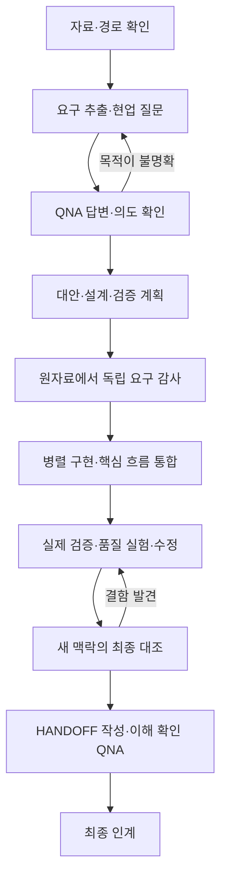

# Project Orchestrator

프로젝트의 요구사항을 이해하고, 사용자와 중요한 판단을 나누며, 병렬 구현·독립 검증·인수인계까지 관리하는 한국어 Codex 스킬입니다. 웹서비스, 업무 자동화, 데이터 처리 등 여러 단계가 연결된 개발 프로젝트에 사용할 수 있습니다.

## 이 스킬로 달라지는 작업 방식

- 프로젝트 시작 시 **무엇이 좋은 결과인지**부터 확인합니다. 명세에 없는 목적·우선순위·절충은 선택지와 장단점이 있는 `QNA.md`로 묻습니다.
- 사용자가 문서에 답하면 파일을 다시 읽습니다. 답의 의미와 목적을 먼저 해석하고, 중요한 모호함을 해결한 뒤 작업합니다.
- 답변 원문과 사용자 목적을 `USER_INTENT.md`에 보존합니다. 맥락이 길어지거나 세션을 재개해도 최신 결정을 읽고 이어갑니다.
- 메인 에이전트가 역할·의존성·수정 경로를 정해 독립적인 일을 병렬로 맡깁니다. 새 맥락 감사자는 메인의 결론을 보기 전에 원자료에서 요구사항을 추출합니다.
- 구현 결과와 함께 실제 실행 근거를 남깁니다. 마지막에는 선택 이유·코드 흐름·검증·실패 대응·품질·AI 협업을 설명할 수 있는 `HANDOFF.md`를 만듭니다.

## 사용하기

스킬은 [`skills/project-orchestrator/`](skills/project-orchestrator/) 폴더 하나로 독립 동작합니다. 하위 참조 문서와 양식을 함께 가져오세요. 별도 Python 패키지나 외부 API는 필요 없습니다. Python 초기화 도구는 선택 사항입니다.

설치 기능이 제공되는 환경에서는 이 저장소의 스킬 폴더를 지정해 설치할 수 있습니다. 저장소 단위로 사용할 때는 해당 폴더를 프로젝트의 `.agents/skills/` 아래에 두는 방식을 지원합니다. 설치 경로나 지원 기능이 다른 환경에서는 그 환경의 허용된 방식으로 `SKILL.md`를 읽게 하면 됩니다. 스킬 때문에 도구 버전이나 설정을 임의 변경하지 않습니다. [공식 스킬 안내](https://learn.chatgpt.com/docs/build-skills)

호출 예시의 대괄호 부분은 **사용할 때 직접 지정**합니다.

~~~text
$project-orchestrator

작업 경로: [실제 프로젝트 폴더]
요구사항 자료: [README 등 경로, 여러 개 가능]
현업 자료 또는 질의 채널: [대화 기록 경로 / 사용 가능한 채널 / 없음]
기록 경로: [이 프로젝트의 QNA와 검증 기록을 저장할 폴더]
수행 시간과 제약: [남은 시간, 산출물, 허용 도구·자료 등]

이 자료를 바탕으로 프로젝트를 진행하고, 주요 설계와 검증 결과를 내가 이해하고 이어갈 수 있도록 정리해줘.
~~~

경로를 빠뜨리면 임시 QNA 문서의 실제 위치를 알려주고 누락 값을 묻습니다. 다른 프로젝트의 경로나 과거 대화의 요구를 자동으로 가져오지 않습니다.

## 문서로 답하는 방식

1. 에이전트가 `QNA.md`에 현재 필요한 질문을 적습니다. 추천안, 다른 선택, 이점과 포기하는 점을 함께 읽습니다.
2. 각 질문의 **사용자 답변**에 선택과 이유를 적습니다. 정해진 선택지가 맞지 않으면 직접 제안할 수 있습니다.
3. 채팅에 “QNA 수정했어”라고 알립니다. 에이전트가 디스크의 실제 내용을 다시 읽습니다. 파일 수정만으로 자동 재개한다고 가정하지 않습니다.
4. 에이전트는 답변 원문과 자신의 해석을 구분합니다. 명확하면 반영하고, 목적이 갈리면 필요한 차이만 후속 질문으로 확인합니다.

답변을 기다리는 동안에도 독립적인 조사·검토는 진행합니다. 빈칸이나 추천 표시를 동의로 처리하지 않습니다. 기존 답을 바꿀 수 있으며, 변경된 결정에 연결된 작업만 다시 검토합니다.

## 처음부터 끝까지

각 단계는 근거와 상태를 기록합니다. 시간이 부족해도 단계를 지우지 않고 미완료 항목과 영향을 남깁니다. 스킬은 절차를 안내하는 지침이며, 단계 이행을 강제로 보장하는 별도 실행 엔진은 아닙니다.

## 생성되는 기록

| 문서 | 용도 |
|---|---|
| `QNA.md` | 선택지·trade-off와 사용자가 직접 쓰는 답변 |
| `USER_INTENT.md` | 사용자 목적·우선순위·제약과 변경 근거 |
| `REQUIREMENTS.md` | 원자료의 조건을 코드·검증에 연결한 추적표 |
| `WORKLOG.md` | 단계 상태, 작업 그래프, 실제 서비스 흐름, 결정·실행·협업 근거 |
| `HANDOFF.md` | 프로젝트 요약, 설계 선택과 동작 원리, 검증 근거, 알려진 한계와 다음 작업 |

기존 프로젝트 문서가 같은 역할을 하면 매핑해 사용합니다. 원래 프로젝트가 요구하는 파일 이름과 산출물 형식은 그대로 지킵니다. 사용자 목적 문서는 QNA와 분리해 유지합니다.

선택적 초기화 도구는 지정한 경로에 네 작업 문서의 양식을 생성합니다. 자료 분석과 구현은 이후 스킬의 작업 흐름에서 진행합니다. 기존 이름의 파일이 하나라도 있으면 전체 초기화를 거부하므로, 재개할 때는 기존 문서를 읽으세요.

~~~text
python skills/project-orchestrator/scripts/init_workspace.py --project-dir "[프로젝트 폴더]" --artifact-dir "[기록 폴더]" --source "[명세 파일]"
~~~

`--source`와 `--stakeholder-source`는 여러 번 지정할 수 있습니다. `--time-budget`에는 남은 시간을 설명하는 문자열을 넣습니다. Python이 없으면 양식을 직접 복사해 같은 절차로 진행합니다.

## 검토와 적용 범위

하위 에이전트는 실제 제공되는 기능과 동시 실행 한도 안에서 사용합니다. 새 맥락을 지원하지 않는 환경에서 독립 검토를 수행했다고 표시하지 않습니다. 역할별 분리와 읽기 중심 병렬 검토는 공식 하위 에이전트 안내의 활용 방식과도 맞습니다. [공식 하위 에이전트 안내](https://learn.chatgpt.com/docs/agent-configuration/subagents)

기술 스택과 구현 방식은 프로젝트의 목적과 제약에 맞춰 정합니다. 검증 결과에는 실제로 확인한 범위와 한계를 함께 남깁니다. 프로젝트 자료·현업 기록·개인 답변은 지정한 작업 폴더에서 관리하며, 이 공개 저장소에 자동 업로드하지 않습니다.

## 확인한 범위

초기화 도구의 테스트 6개로 UTF-8 문서 생성, 기존 답변 보존, 재초기화 거부, 잘못된 경로 처리, 자료 위치 기록을 확인했습니다. 실행 명령은 `python -B -m unittest discover -s tests -v`입니다.

별도의 예제 프로젝트에서 QNA 답변 접수, 병렬 구현, 원자료에서 시작하는 독립 검토, 실행 검증, 인수인계 문서 작성 흐름을 확인했습니다. 예제 제품의 검사 10개와 작은 입력을 독립적으로 검산한 사례 14개를 실행했습니다. 자료 전달과 사용자의 이해 확인을 구분하는 동작도 점검했습니다. 이 검사는 모든 모델·실행 환경·프로젝트에서 동일한 수행을 보장하지 않습니다.

이전 대화를 받지 않은 새 에이전트로 작업 재개도 점검했습니다. 변경된 QNA 답변을 읽어 목적과 영향을 갱신하고, 이전 원문·실행 근거를 보존하며, 현재 요청이 계획까지만 허용할 때 제품 코드를 수정하지 않는 것을 확인했습니다.
